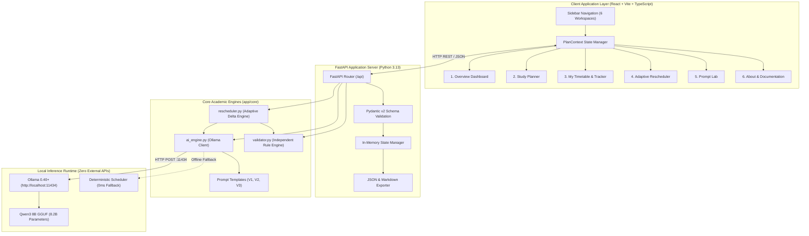

# StudyFlow AI — Architecture & Systems Specification

> **Registered Academic Project**  
> **Course**: Prompt Engineering  
> **Team**: Innovex  
> **Team ID**: PE-B25-52  
> **Problem Pool ID**: C20  
> **Product Name**: StudyFlow AI  
> **Team Leader**: Gaurav Singh (S24CSEU0790)  
> **Team Member**: Adarsh Dubey (S24CSEU1579)

---

## 1. Executive Summary

**StudyFlow AI** is an academic productivity and cognitive scheduling platform. It addresses the fundamental flaw of naive LLM wrappers: generative language models hallucinate impossible time durations, produce overlapping slots, ignore cognitive rest, and completely collapse when a student encounters a real-world disruption.

StudyFlow AI solves this with a **three-tier architecture**:
1. **Editorial Application Layer**: React 19 + TypeScript + Tailwind CSS + Lucide Icons + Recharts, structured into six dedicated academic workspaces with genuine session state tracking.
2. **API & Rule Engine**: FastAPI + Pydantic, enforcing deterministic input validation, schedule parsing, state preservation, and export generation.
3. **Inference & Constraint Logic**: Local Ollama runtime executing `qwen3:8b` via private loopback HTTP inference with a 100% deterministic fallback and an independent 8-rule Python validator.

---

## 2. System Architecture Diagram

---

## 3. The Three Tiers

### Tier 1: Client Application Shell
- **Responsive Layout**: Sidebar rail with 6 workspaces and persistent top bar.
- **Editorial Styling**: Midnight navy (`#17243A`), warm ivory (`#F5F3EF`), muted sage (`#B9C9B8`), restrained amber (`#D8A66A`), slate (`#64748B`), and neutral borders (`#E5E1DA`).
- **Interactive Session Tracking**: Checkboxes persist session completion states optimistically in React state and sync via `PATCH /api/sessions/{session_id}`.
- **Real-Time Instrumentation**: Live progress percentage, duration counters, and nearest-deadline countdowns.

### Tier 2: FastAPI Backend Services
- **Asynchronous & Typed**: Strict Pydantic models for all payloads (`GeneratePlanRequest`, `ValidatePlanRequest`, `RescheduleRequest`, `PromptTestRequest`).
- **CORS Configured**: Secure local development and production origin matching.
- **State Management**: Server-side plan state synchronization across export operations.

### Tier 3: AI Inference & Deterministic Constraint Verification
- **Local Ollama Execution**: Fully offline `qwen3:8b` model called with `"think": False` for high-speed structured JSON generation.
- **Deterministic Python Validator**: Independent of model weights, enforcing all 8 academic constraints.
- **Adaptive Rescheduler**: Guarantees preservation of completed sessions and computes explicit human-readable delta summaries.
